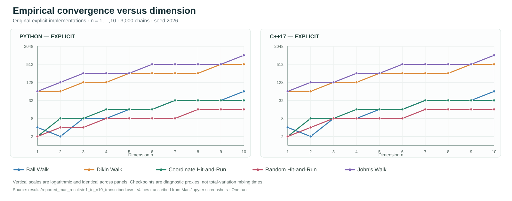
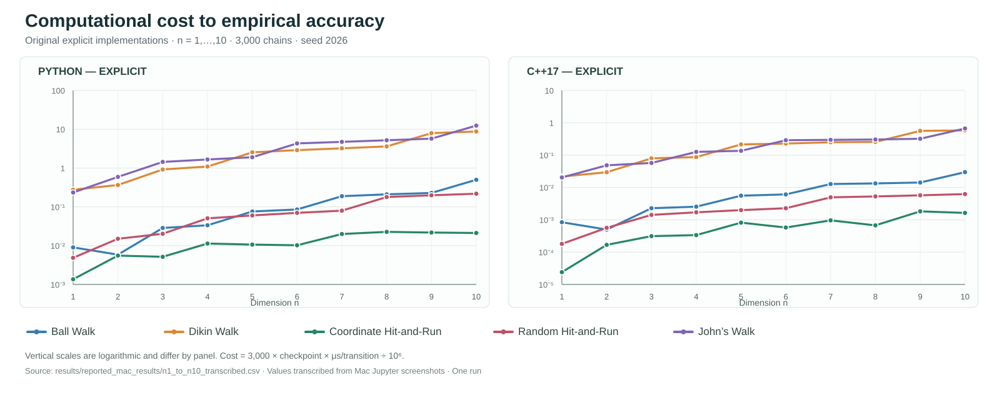
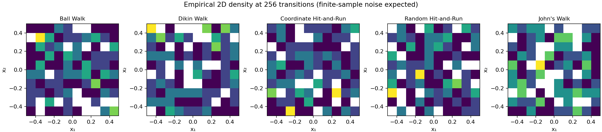
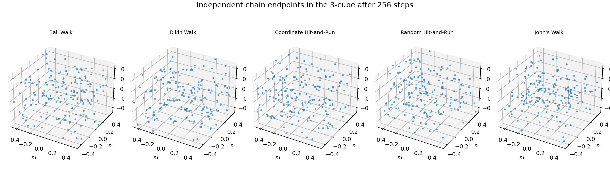
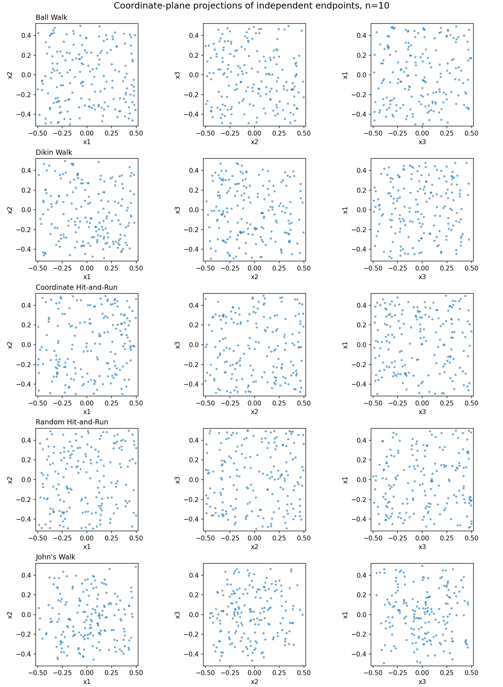

# Experiments on Random Walks

**Python and C++ experiments in convex geometry — from explicit transition rules to faster implementations**

I study five random walks on the centred cube

\[
K_n=[-1/2,1/2]^n,\qquad X_0=0,\qquad n\geq1.
\]

My starting question is geometric: how does a chain initiated at the origin spread through the cube, and how does its distribution change as the dimension increases? I then distinguish two measures of performance: *the number of Markov transitions required to reach a stated empirical discrepancy criterion* and *the computation spent on those transitions*. These are not interchangeable.

This repository retains **two complete implementations**, both in Python and C++17:

| Stage | Python | C++ | Purpose |
|---|---|---|---|
| Explicit implementation | `baseline/python/walks.py`, `baseline/python/experiment.py` | `baseline/cpp/walks.cpp` | Read and inspect the geometry and probability calculation step by step |
| Optimized implementation | `python/fast_walks.py`, `python/experiment_fast.py` | `cpp/walks_optimized.cpp` | Study numerical throughput with batched NumPy updates, reused buffers, and optional C++ threading |

The five walks are **Ball Walk**, **Dikin Walk**, **Coordinate Hit-and-Run**, **Random Hit-and-Run**, and **John's Walk** (the symmetrized-body formulation specialized to the cube). The mathematical definitions, proposal supports and acceptance corrections are stated in [the mathematical methods](docs/01_MATHEMATICAL_METHODS.md). The general-body definitions and theoretical results in the cited literature should not be confused with numerical observations from this cube implementation.

## The questions I investigate

1. For fixed dimension \(n\), how do the five distributions evolve from the same starting point? What do their densities, projected point clouds, and discrepancy curves show?
2. As \(n\) changes, how do the recorded empirical convergence checkpoints and computational costs change?
3. For each sampling rule, what computational changes are obtained when I use NumPy batching in Python or memory reuse / optional parallelism in C++?
4. How much information do the chosen empirical diagnostics lose? Coordinate Hit-and-Run gives an exact total-variation reference against which I can test the reported proxy checkpoints.

## Results at a glance — dimensions 1 to 10

I first investigated how the five transition rules behave as the cube dimension varies from $n=1$ to $n=10$. The following plots present the **original, explicit Python and C++17 implementations**, before NumPy batching and C++ parallel optimization. They reproduce the dimension-sweep observations reported from my Mac Jupyter experiments (2,560-step budget, 3,000 chains, one seed: 2026). Values were transcribed from the saved screenshots; they are not a fresh controlled rerun.

### 1. Empirical convergence checkpoints



The vertical axes are logarithmic. Random Hit-and-Run often reaches the chosen **empirical discrepancy criterion** in fewer steps, whereas Dikin Walk and John's Walk require more under these specific algorithm parameters. **These checkpoints are not certified total-variation mixing times.** In particular, one-dimensional marginal agreement need not imply convergence of the joint law.

### 2. Estimated computational cost to the same empirical criterion



I estimate the elapsed transition cost to each recorded checkpoint as $3000 \times t_{\mathrm{checkpoint}} \times c_{\mathrm{transition}}/10^6$ seconds, where $c_{\mathrm{transition}}$ is the measured microseconds per simulated transition. **The two panels use different vertical scales**; this is an estimate rather than a separately timed truncated run. For most dimensions, Coordinate Hit-and-Run has the smallest estimated cost even when Random Hit-and-Run has a smaller empirical checkpoint.

[Source data for these figures](results/reported_mac_results/n1_to_n10_transcribed.csv) · [Detailed measurement caveats](docs/02_MEASUREMENT_AND_LIMITATIONS.md) · [Optimized versus explicit Mac timings at n=20](docs/08_MAC_PERFORMANCE_NOTES.md)

### 3. Geometric illustrations

These are selected **development-environment examples**, not the same raw Mac runs used for the dimension-sweep plots. I include them to make the spatial behaviour visible alongside the numerical tables.

| Two-dimensional density | Three-dimensional endpoint clouds | Higher-dimensional coordinate projections |
|:--:|:--:|:--:|
|  |  |  |
| $n=2$ | $n=3$ | $n=10$ |

The optimized study is a separate stage: its code and curated $n=20$ example are retained in the repository, while the runners accept arbitrary positive integer dimensions subject to computational resources.

## Run an optimized experiment — both languages, one command

On macOS, from this folder:

```bash
conda activate random-walks-viz
python -m pip install -r requirements.txt
python run_all.py --dimensions 20 --steps 2560 --chains 3000 --seed 2026 --repeats 1 --threads 4
```

This compiles C++, runs all five walks in **optimized Python and C++**, calculates comparison matrices, generates figures and saves a new dated folder inside `runs/` without overwriting older experiments. `--dimensions 1:10` evaluates dimensions 1 to 10. `--dimensions 2,3,5,10,20` evaluates the listed dimensions. Larger dimensions are possible subject to available time and memory.

To run **both research stages** (explicit and optimized, Python and C++) with matching parameters in one invocation:

```bash
python run_both_versions.py --dimensions 2,3,5 --steps 128 --chains 300 --seed 2026 --threads 1
```

For the full \(n=20\) comparison, replace those values with `--dimensions 20 --steps 2560 --chains 3000`; the explicit Python implementation is substantially slower. Use `--threads 1` to compare C++ single-thread results, and repeat the optimized run with `--threads 4` when studying throughput from multicore execution. The original is not a maximum-performance Python benchmark.

For the notebook interface, launch `python -m notebook` and open `notebooks/01_full_python_cpp_study.ipynb`. The notebook runs genuine C++ executable code through a Python-driven command; it does not simulate C++ algorithms inside Python. The notebook's configuration cell selects the experiment parameters.

## Run a fresh experiment on the research website

I also provide a [browser experiment runner](https://souravfrp.github.io/Experiments-on-Random-Walks/#run-experiment) for readers who want to choose their own dimension, number of steps, chains and seed and immediately see computed results without installing the Python/C++ code. The site runs all five cube transition rules (or one selected walk) **locally in JavaScript**, displaying empirical convergence curves, endpoint projections, acceptance information and an exportable CSV.

The browser engine is an **independent implementation** of the mathematical proposals and acceptance corrections; it does **not** execute my native Python/C++ executables. Its random-number generator and elapsed-time measurements are also different, so I do not treat its results as direct Python-versus-C++ performance evidence. Browser limits (currently n ≤ 30 and a bounded work budget) are practical safeguards, not restrictions of the mathematical algorithms.

The public site thus has **two separate functions**: (1) compute a *new* result locally from visitor-chosen parameters, and (2) search *previously published* results from my curated research archive. The latter can only show parameters represented in the recorded data and never fabricates a missing measurement. Neither function automatically collects the visitor's experiment. I document the implementation details and the limits of its mathematical interpretation in [browser experiment notes](docs/09_BROWSER_EXPERIMENTS.md).

## Search the public experiment archive

I maintain a [searchable public experiment index](https://souravfrp.github.io/Experiments-on-Random-Walks/) for the compact summaries I have reviewed and published. It supports filtering by dimension, walk, Python or C++, explicit or optimized implementation, source, step budget, number of chains and seed. Filtered records can be exported as CSV. The page is read-only: neither running a local experiment nor opening the page uploads anyone's data.

The dashboard uses source-labelled records drawn from the published CSVs. Mac screenshot/Terminal transcriptions are separated from development-environment measurements. Where parameters are unknown, I leave them unknown rather than inferring them; an empirical checkpoint is not the total-variation mixing time. I regenerate the index with `python tools/build_public_index.py`, and GitHub Pages rebuilds it from those CSVs at publication. GitHub Pages must be enabled once in repository Settings to make the page available. See [the archive methodology](docs/07_EXPERIMENT_ARCHIVE.md) and [optimization notes](docs/03_OPTIMIZATION_CHANGES.md).

## Archive and results

Each optimized run writes `runs/<timestamp>_<id>/parameters.json`, per-language `checkpoints.csv` and `runtime.csv`, selected `snapshots.csv`, `tables/combined_results.csv`, summary matrices, figures, and completion status. `runs/` is ignored by Git because large generated outputs should not accumulate in ordinary commit history. A researcher can choose to publish **selected small summaries**, not every coordinate of every trajectory.

The curated examples under `results/` include:

- `example_development_n1_to_n10/` — small demonstration matrices (development environment).
- `example_development_n20/` — checkpoint CSVs and runtime CSVs for a development-environment example, plus exact coordinate-walk reference.
- `reported_mac_results/` — separate observations transcribed from the Mac terminal and Jupyter outputs shared during this study. They are **reported observations**, not a newly imported raw run or a controlled head-to-head benchmark.

Every empirical result should be interpreted with its seed, number of chains, observation grid, hardware, code version and choice of discrepancy. I do not identify a marginal KS threshold with rigorous mixing of the joint law. See [measurement conventions](docs/02_MEASUREMENT_AND_LIMITATIONS.md) and [experiment archive policy](docs/07_EXPERIMENT_ARCHIVE.md).

## How to read the figures

- \(n=1\): histogram on the interval;
- \(n=2\): square point clouds and 2D density;
- \(n=3\): 3D trajectories or cloud of independent endpoints;
- \(n\geq4\): coordinate-plane projections such as \((x_1,x_2)\), \((x_2,x_3)\), and \((x_3,x_1)\).

A projection is not the full \(n\)-dimensional distribution. Multiple diagnostics and the exact Coordinate Hit-and-Run benchmark are needed to assess how much a projection can conceal.

## Repository layout

```text
baseline/python/       explicit Python kernels and experiment script
baseline/cpp/          explicit C++ source
python/                optimized Python kernels, diagnostics and figures
cpp/                   optimized C++17 source
notebooks/             Jupyter workflow for Python + C++
docs/                  geometry, convergence, references, research notes
results/               curated, compact historical/example records
figures/examples/       selected illustrative graphs
benchmarks/            development-environment reference/optimized trials
tests/                 mathematical and code-level checks
.github/workflows/      small automated checks on pushes and PRs
run_all.py             one-command optimized Python+C++ experiment
run_both_versions.py   one-command explicit+optimized comparison
runs/                  local generated results (not committed)
```

## Verification and reproducibility

Run `python -m unittest discover -s tests -v`. Code tests are necessary but do not prove the spectral gap, total-variation mixing bounds, or perfect equivalence of independently implemented RNG streams. Identical seeds across Python/C++ do not mean identical sample paths. Proposal parameters are specified in the method notes and should not be presented as universally optimal.

The timing measurements include numerical throughput, but not necessarily the same amount of plotting, compilation, I/O or diagnostic time. On C++ the optimization result also depends on `-O2` versus `-O3` and the number of worker threads. Numerical results must be compared under explicitly stated conditions.

## Mathematical sources

I have separated citations to the underlying walks from citations to programming packages. The primary mathematical references and their links appear in [sources](docs/04_SOURCES.md). Python's `random`/`math` and standard C++ are sufficient for the explicit code. NumPy is used in the faster Python code because updating many independent chains at once is computationally useful; Matplotlib is used for plotting rather than to implement the Markov kernels.

---

## Appendix — What changed to reduce computational cost?

I keep this account at the end so that the mathematical experiment remains the focus.

**Python.** In the explicit version, each transition is applied to an individual chain through ordinary Python lists, `random` draws and loops. In the optimized version, a NumPy `float64` array of shape `(chains, n)` allows many chain updates to be evaluated in batches. The Dikin Hessian is still computed from the logarithmic barrier, the Hit-and-Run chord endpoints are still calculated, and the acceptance rules remain explicit. Scaling a Gaussian direction is unnecessary for Hit-and-Run because uniform chord sampling is invariant to direction rescaling. Selected snapshots are written instead of the entire path history.

**C++.** The explicit version uses the C++17 standard library and clear vector operations. The optimized version retains scratch vectors in per-worker workspaces and avoids repeated allocations. It gives independent chains reproducible streams and can assign different chains to different threads. The optimized compiler command uses `-O3`; the baseline uses `-O2`. A claim that *memory reuse alone* caused the full speedup would therefore be unjustified unless the compiler and thread conditions were controlled.

**Observed Mac timings.** For the \(n=20\), 2,560-step, 3,000-chain experiment, the previously reported total times per walk and the optimized times are tabulated in [Mac execution notes](docs/08_MAC_PERFORMANCE_NOTES.md). These were taken from separately executed runs on the same machine, not a randomized repeated benchmark. They show large practical improvements, but the optimized C++ timing includes four threads and the change from `-O2` to `-O3`. The complete optimization discussion, including cases without speedup, is in [optimization changes](docs/03_OPTIMIZATION_CHANGES.md).

**Interpretation.** Faster execution need not imply fewer mixing steps. For the present thresholds, Random Hit-and-Run often has the earliest *empirical* checkpoint; Coordinate Hit-and-Run often has the lowest measured transition cost. Neither observation constitutes a universal mixing-time theorem. Future work should use more repetitions, verified kernel equivalence and stronger joint-distribution diagnostics.

*These are research-note drafts for the repository author's final review before publication.*
